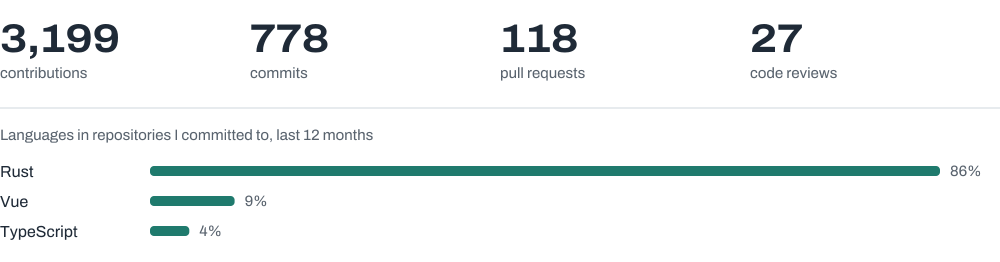

<picture>
  <source media="(prefers-color-scheme: dark)" srcset="./assets/header-dark.svg" />
  
</picture>

I've spent more than ten years building backend systems in .NET, across logistics, finance, pharmacy
and enterprise software. These days most of my work happens at [**Wolfware**](https://wolfware.dev), where we build developer
tools, mostly in Rust: release automation, reporting, real-time messaging and UI.

What keeps me interested is the point where software meets the physical world. When I'm not writing
code I'm usually at the electronics bench or tuning a 3D printer, and the two tend to feed each other:
a part gets designed, printed, wired up, and eventually needs firmware. My dogs supervise all of it.

### Currently building

| Project | What it does |
| --- | --- |
| [Moonlit](https://github.com/wolfware-labs/moonlit) | Build and release automation. YAML pipelines, plugins as sandboxed WebAssembly components. |
| [Golden Reports](https://github.com/wolfware-labs/golden-reports) | One report definition, every output: embeddable viewer, pixel-perfect PDF, native Excel, labels. |
| [Remora](https://github.com/wolfware-labs/remora) | Records what an AI coding agent does to your files and rewinds them to any turn. |
| [Pavia](https://github.com/wolfware-labs/pavia) | Real-time RPC and messaging with typed contracts over WebTransport and WebSocket. |
| [Artic](https://github.com/wolfware-labs/artic) | Cross-platform Rust UI framework: XAML views, one GPU renderer for desktop and mobile. |

### Tools I reach for

  

### Activity

<picture>
  <source media="(prefers-color-scheme: dark)" srcset="./dist/stats-dark.svg" />
  
</picture>

Images regenerate daily from the GitHub API. Typeface: <a href="https://fonts.google.com/specimen/Archivo">Archivo</a> (SIL Open Font License).
